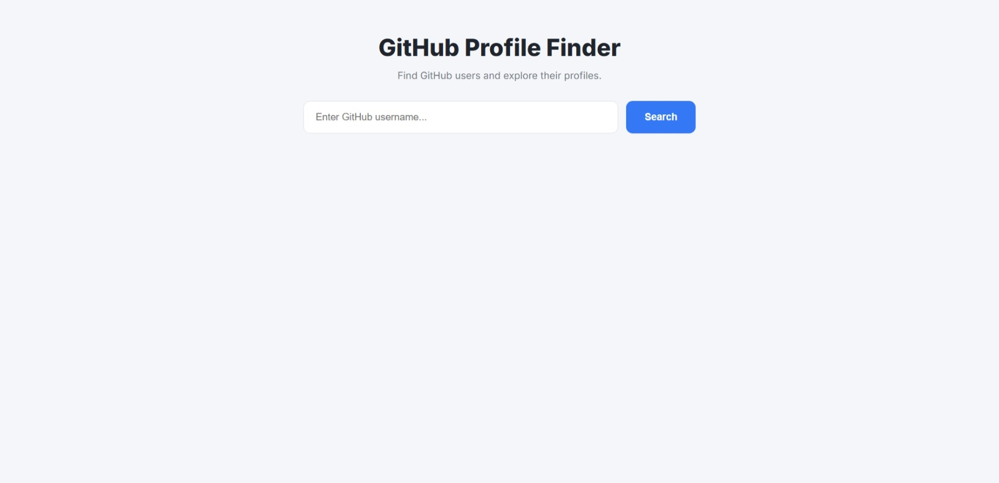

# 🔍 GitHub Profile Finder

A simple and responsive GitHub Profile Finder built using HTML, CSS, and JavaScript. This application allows users to search for GitHub profiles and explore their information and recently updated repositories using the GitHub REST API.

---

## 🌟 Live Demo

👉 View Live Demo: [https://roghayem.github.io/github-profile-finder/]

---

## 🖼️ Preview



---

## ✨ Features

- Search for GitHub users by username
- Display user profile information
- Show profile avatar, name, and bio
- Display followers and following counts
- Show public repository count
- Display user location
- Visit the user's GitHub profile
- Show up to 6 recently updated repositories
- View individual repositories on GitHub
- Handle invalid usernames and API errors
- Responsive design for different screen sizes

---

## 🛠️ Built With

- HTML5
- CSS3
- JavaScript (ES6+)
- GitHub REST API
- Fetch API
- Async/Await
- JSON
- DOM Manipulation
- Array Methods
- CSS Flexbox & Grid
- Media Queries

---

## 🚀 Getting Started

To run this project locally:

1. Clone the repository:

```bash
git clone https://github.com/roghayem/github-profile-finder.git
```

2. Open the project folder:

```bash
cd github-profile-finder
```

3. Open `index.html` in your browser.

---

## 📂 Project Structure

```text
github-profile-finder/
│
├── index.html
├── style.css
├── script.js
├── assest/
│   └── github profile finder.jpeg
└── README.md
```

---

## 📚 What I Learned

Through this project, I practiced:

- Working with external REST APIs
- Using Fetch API to retrieve data
- Understanding Promises and Async/Await
- Working with JSON responses
- Handling API errors
- Dynamically creating HTML elements with JavaScript
- Displaying data from API responses
- Using array methods to display repositories
- Building a responsive user interface

---

## 👩‍💻 Author

**Roghaye Mohammadi**

- GitHub: [@roghayem](https://github.com/roghayem)

---

⭐ If you like this project, feel free to give it a star!
